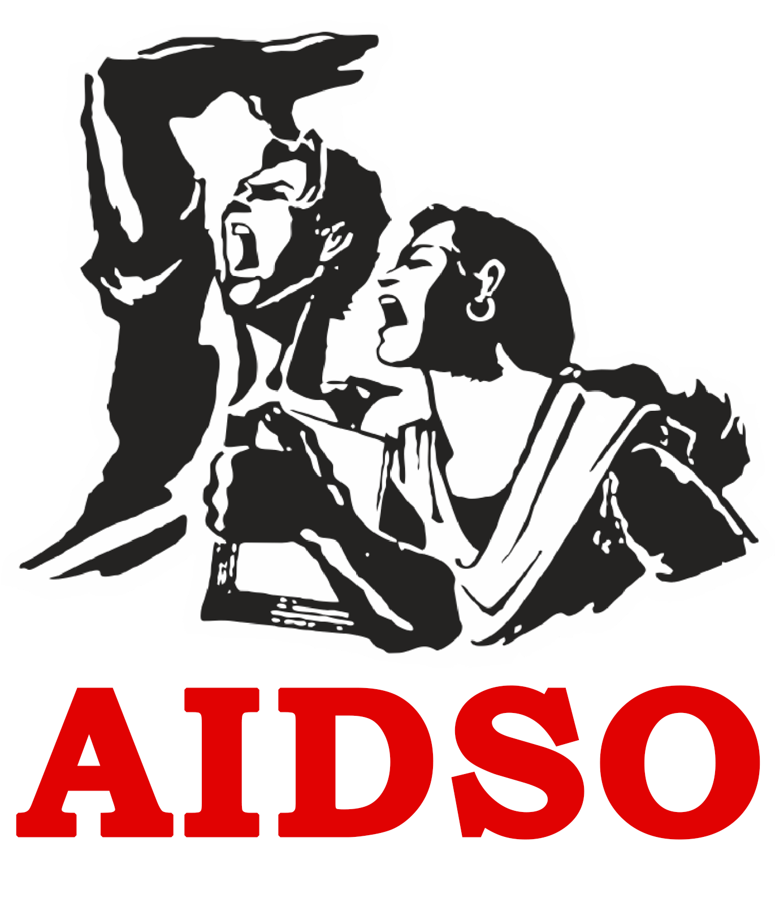

# Posterframes — Agentic Poster & Graphic Design Engine

Posterframes enables AI agents (Antigravity, Claude Code, Codex) to act like an **expert Art Director & Senior Graphic Designer**. Instead of building raw text boxes or floating web containers, the agent follows strict spatial budgeting, visual hierarchy, typography lockups, and image treatments to compose professional posters using HTML, Tailwind CSS, SVG, and Chromium.

---

## 🛡️ Strict Layout Laws & Verification Engine (Zero Overlap & Deterministic Audit)

> [!IMPORTANT]
> **THE 4 MANDATORY ENGINEERING LAWS FOR POSTER GENERATION**
> Visual inspection alone gives false positives ("looks fine" to an LLM even when text clips a leader's nose or collides with a badge). Every poster MUST adhere to these 4 deterministic rules.

### 1. No Freeform Absolute Text
- **FORBIDDEN**: Never position text elements (`h1`, `h2`, `p`, `blockquote`, dates, subtitle badges, organizational footers) using freeform `position: absolute` with guessed `top`, `bottom`, `left`, or `right` coordinates.
- **MANDATORY**: All text and logos must live inside structured **CSS Grid or Flexbox layout zones** (e.g. columns, cards, banners) with explicit `gap`, `padding`, and `max-width` constraints.
- Only the **hero cutout/portrait**, **background art/textures**, and **primary structural zone containers** (e.g. left column container, right column container, flush footer bar) are allowed to have absolute positioning on the canvas root. All children inside them must follow normal flow with flex/grid.

### 2. Mandatory `data-layer` Tagging
Every HTML poster must explicitly tag elements with their architectural layer:
- `data-layer="background"`: Background textures, gradients, decorative frames, ambient glows (`z-index <= 5`). Ignored during collision audits.
- `data-layer="subject"`: Cutout or feathered portraits (e.g., `che-portrait.png`, `che-feathered.png`, `che-grabcut.png`).
- `data-layer="container"`: Structural cards, badges, ribbons, and footer bars. Allowed to contain child content elements and allowed to overlap the bottom 20% of a `subject` portrait as a grounded anchor.
- `data-layer="content"`: All text nodes (kicker, headlines, dates, quotes, attributions, committee names) and brand logos (`aidso-emblem.png`, `aidso-students-black.png`, `aidso-students-white.png`).

### 3. AIDSO Brand Header & Footer Rules
Standardize how brand identity assets are integrated into posters:
- **Lock Height and Aspect**: Always wrap logos in fixed containers with `object-fit: contain` (e.g. `w-20 h-20` for circular emblem, `h-10 md:h-12 w-auto` for student silhouettes). Never let logos stretch or float unconstrained.
- **Background-Aware Asset Pairing**:
  - On **dark or black footers/cards**: Use `aidso-emblem.png` (in white circular pill or badge) and `aidso-students-white.png` (white silhouette).
  - On **light parchment or white cards**: Use `aidso-students-black.png` (black silhouette) or dark crimson typography.
- **Flush Footer Architecture**: The footer banner must sit flush at `bottom-0 w-full` with explicit padding (e.g., `px-12 py-5`) and stay at least 3% (48px on 1600px artboard) clear of outer borders for text legibility.

### 4. Mandatory CLI Audit Loop (Trust the Auditor Over Vision)
- Before claiming any poster is complete, run:
  ```bash
  posterframes verify poster.html
  # Or during rendering:
  posterframes render poster.html --scale 2 --out poster.png
  ```
- If the auditor reports ANY errors (`CONTENT_OVERLAP`, `PORTRAIT_COLLISION`, `OCCLUSION_ERROR`, `SAFE_ZONE_VIOLATION`, `SPACING_TOO_TIGHT`, `EXCESSIVE_DEAD_SPACE`, `CONTAINER_UNDERFILLED`, `WIREFRAME_BORDER_DETECTED`, `PORTRAIT_HARSH_SEAM`), **you are NOT done**.
- The CLI rendering pipeline automatically enforces a gate: any layout audit failure exits with a non-zero exit code.
- **Use `--debug-boxes` to diagnose:**
  ```bash
  posterframes render poster.html --debug-boxes --out debug-audit.png
  ```
  This paints color-coded mathematical bounding boxes:
  - 🟢 **Green**: Content bounding boxes
  - 🔴 **Red**: Collision/overlap zones
  - 🔵 **Cyan Dashed**: Subject boundary & alpha-hit points
  - 🟡 **Yellow**: Vertical spacing rulers between siblings
- Iterate on the HTML/CSS until the auditor outputs:
  `✅ LAYOUT AUDIT PASSED (0 overlaps, 0 occlusions, 0 boundary violations)`.

---

## 🎨 Graphic Design Taste & Visual Hierarchy Laws

> [!IMPORTANT]
> **AESTHETIC TASTE & PROPORTIONAL COMPOSITION CONTRACT**
> Passing bounding-box collision tests is only the baseline. A poster must have deliberate art direction, balanced vertical rhythm, and authentic editorial graphic styling.

### 1. Canvas Background & Atmosphere
- **Never use sterile `#FFFFFF` with plain black wireframe boxes.**
- Use rich, tactile editorial palettes:
  - Warm archival paper: `#F6F2EA` or `#F2ECE1` with a subtle radial lighting gradient (`radial-gradient(circle at 65% 40%, #FFFDF9 0%, #F5EFE6 60%, #EAE2D5 100%)`) and paper grain texture (`opacity-[0.035]`).
  - Commemorative themes: Deep charcoal/slate (`#0F172A`) or rich crimson/burgundy duotone split layouts.

### 2. Portrait Integration (Zero Visible Photo Rectangles)
- **Cutout Portraits (`che-grabcut.png`):** Ensure the background around the subject is 100% transparent (`alpha = 0`). Ground the subject's torso flush against the bottom footer bar or a lower-third ribbon.
- **Rectangular or Dark-Background Photos (`che-raw.jpg`, `che-portrait.png`):** NEVER let a raw photo rectangle end abruptly mid-page against a light canvas. Either:
  - **Multi-Stop Composite Mask:** Apply CSS `mask-image: linear-gradient(to right, transparent 0%, black 28%), linear-gradient(to bottom, transparent 0%, black 18%);` so the photo edges dissolve imperceptibly into the canvas.
  - **Architectural Framing:** Set the portrait inside an intentional editorial frame (e.g., full-height split column, bold circular arch medallion with crimson/gold accent rings, or dark matching canvas).

### 3. Editorial Quote Styling (No Wireframe Boxes)
- **Banned:** Plain `2px solid black` rounded rectangles with white fills floating on white canvases.
- **Mandatory Editorial Treatment:**
  - Large decorative quote glyph: `font-size: 3.5rem+`, bold crimson `#C62828` or `#DC2626`, leading-none.
  - Bold accent rule: `border-left: 5px solid #C62828` or `#DC2626`.
  - Warm tinted card surface: subtle surface fill (`rgba(198, 40, 40, 0.035)` or `#EFECE6` / `#FAF7F2`) with `p-7` or `p-8`.
  - Readable typography: generous font scale with `line-height: 1.55–1.65` that naturally fills $\ge 50\%$ of the card area.

### 4. Compact, High-Contrast Date Badge
- Date badges (`09 ಅಕ್ಟೋಬರ್ 2026`) must use `width: fit-content; height: fit-content;` with tight, balanced padding (`14px 22px` to `16px 26px`).
- Never float date numerals inside an oversized empty rectangle ($> 35\%$ empty padding is banned).
- Apply strong typographic hierarchy: bold primary numeral (`09`), thin decorative divider rule (`border-t border-red-500/30`), and crisp month/year lockup.

### 5. Cohesive Left-Column Flow (No Middle Dead-Hole)
- **Banned:** Unconstrained `justify-content: space-between` across a 1300px+ column for only 2 items.
- **Mandatory Rhythmic Cadence:** Structure the left column with intentional spacing (`gap: 32px–48px`):
  1. Top: Commemorative quote card with red accent bar.
  2. Middle divider: Subtle typographic ornament, star glyph (`★`), or crimson divider line.
  3. Bottom: Typographic lockup stack (`ಸಾಮ್ರಾಜ್ಯಶಾಹಿ ವಿರೋಧಿ ಕ್ರಾಂತಿಕಾರಿ ಹೋರಾಟಗಾರ` $\rightarrow$ monumental crimson `ಚೆ ಗುವಾರ` $\rightarrow$ occasion subline $\rightarrow$ dark contrast tribute badge `ನಮ್ಮ ಗೌರವ ನಮನಗಳು!!`).
  - No gap between adjacent visual blocks may exceed `14%` of canvas height (224px on 1600px A4).

### 6. Balanced Organization Footer
- In the flush bottom footer bar (`h-[175px]` to `h-[185px]`):
  - **Left:** Official `aidso-emblem.png` circular emblem + 3D `AIDSO ಕರ್ನಾಟಕ` typography.
  - **Center/Right:** Balance with the full English organization identity (`All India Democratic Students' Organisation`) or clean crimson accent rules so the full width looks cohesive and intentional.

---

## 🎨 The Art Director's Rulebook for User Assets

When a user provides photos, speaker headshots, portraits, logos, or backgrounds, **never just drop an unstyled `` tag into an empty flexbox**. Treat every asset with intentional graphic effects:

### 1. Transparent Cutouts (Leaders, Speakers, Products, VIPs)
- **Scale Dominance**: Cutout portraits must occupy **45% to 65% of the total canvas area**. They are the visual anchor of the poster.
- **Edge Grounding & Bleed**: Ground the subject! Either let their torso/shoulders bleed off the bottom or side canvas edge, or rest them flush against a solid contrast color block. **Never let a cutout float like a tiny postage stamp in the middle of dead space.**
- **Backlight Glow / Halo**: Place a soft radial gradient directly behind the subject (`w-[500px] h-[500px] rounded-full bg-gradient-to-tr from-red-500/30 to-amber-500/20 blur-3xl -z-0`) to separate them from the background.
- **Deep Contact Shadow**: Add a cinematic drop shadow: `drop-shadow-[0_25px_35px_rgba(0,0,0,0.6)]`.
- **Bottom Scrim Fade**: To prevent harsh straight cutoffs at the waist/legs when not bleeding off canvas:
  ```html
  <div class="absolute inset-x-0 bottom-0 h-36 bg-gradient-to-t from-[#09090b] to-transparent pointer-events-none z-20"></div>
  ```

### 2. Framed Photographic Portraits (Non-Cutout Photos)
- If a photo has its own background and cannot be cut out:
  - Wrap it in a **prestigious double-border archival frame**:
    ```html
    <div class="p-2 bg-white/10 backdrop-blur-md rounded-2xl border-2 border-amber-400/80 shadow-2xl">
      
    </div>
    ```
  - Or use a classic editorial rectangular frame with gold/maroon trim (like the classic AIDSO portrait series).

### 3. Full-Bleed Backgrounds & Textures
- **Never use plain, flat, empty color fills for large posters.** Apply subtle atmospheric texture:
  - Parchment / Paper grain (`.pf-grain-overlay` or subtle SVG grid).
  - High-contrast geometric color blocks (e.g. diagonal split between cream paper top and deep crimson/maroon bottom).
- **The Scrim Mandate**: Never overlay white or light text directly onto a photograph without a solid or gradient scrim:
  ```html
  <div class="absolute inset-0 bg-gradient-to-t from-slate-950 via-slate-950/75 to-slate-950/40"></div>
  ```

### 4. Partner & Sponsor Logos & Footers
- **Height Normalization**: Lock all logos to uniform scale: `h-8 md:h-10 w-auto object-contain`.
- **Footer Flushness**: Organization footer banners (e.g., AIDSO Karnataka, sponsor bars) must sit **flush against the bottom edge** (`bottom-0 w-full`), never floating loosely above the bottom margin.

### 5. Built-in Scannable QR Codes
- Run `posterframes qr <url-or-text> --out qr.svg` to produce a sharp vector QR code.
- Place inside a high-contrast white card with explicit call-to-action text.

---

## 📐 Layout Contract (applies to EVERY poster, any size or ratio)

### 0. Read the canvas first, never hardcode it
Take width (W) and height (H) from the chosen preset or the user's request.
Classify orientation:
- **portrait**: H > 1.15 × W
- **landscape**: W > 1.15 × H
- **square**: otherwise
Set CSS variables once on the canvas root and use ONLY these for all sizing:
```css
--W: <width>px;
--H: <height>px;
--u: calc(min(var(--W), var(--H)) / 100);   /* 1u = 1% of the short side */
```

### 1. Canvas root: one fixed container, nothing flows outside it
```html
<div id="canvas" class="relative overflow-hidden"
     style="--W:1080px;--H:1350px;--u:calc(min(var(--W),var(--H))/100);
            width:var(--W);height:var(--H)">
  ...all layers inside...
</div>
```
Never use body flow, auto heights, margins between sections, or min-h-screen.

### 2. Four layers, in z-order
- **L0 background**: color, gradient, or full-bleed image (`absolute inset-0 object-cover`)
- **L1 hero asset**: photo or cutout, `absolute`, positioned in %
- **L2 decoration**: shapes, overlays, gradients for text contrast
- **L3 text**: always on top

### 3. Zone grid that adapts to orientation
Use one absolute grid with `p-[5u]` safe margin. Row/column fractions MUST sum to 100%.
- **portrait**: `grid-template-rows: 12% 46% 27% 15%`   (header / hero / message / footer)
- **landscape**: `grid-template-columns: 45% 55%`        (text column / hero column), text column rows: `20% 50% 30%`
- **square**: `grid-template-rows: 14% 44% 28% 14%`
Adjust the numbers to match the reference poster, but they must still sum to 100%.
Every zone's content is aligned inside its zone with flex (`justify-between` or `justify-center`). No empty zones. If a zone feels empty, enlarge its content or merge it with a neighbor instead of leaving a gap.

### 4. Spacing scale (in u): 2, 4, 8, 16 only. Safe margin = 5u on all sides.
No other gaps. Never use arbitrary margins.

### 5. Typography scale (in u, relative to the short side)
- **headline**: 9–14u, bold/black weight, line-height 1.0–1.1
- **subhead**: 4–6u
- **body/details**: 2.6–3.5u
- **minimum text anywhere**: 2.2u
Posters need strong size contrast: headline at least 3x body. Web-size text (16px on a 1080px canvas) is the #1 reason output "doesn't look like a poster".
Kannada text: use a Kannada font, line-height at least 1.3, and never tight tracking.

### 6. Assets
- Keep all files in `./assets/`, reference them relatively (`./assets/name.png`).
- Backgrounds: `object-fit: cover`. Logos: `contain`, with explicit width in `u`.
- Never let an image size itself. Give every image an explicit width/height or absolute box.
- Hero image should fill at least 40% of the canvas area. Let it bleed off an edge for a poster feel.

### 7. Before writing HTML when a reference poster is given
First write a layout spec: orientation, zone percentages, font sizes in `u`, colors (hex), asset positions in %. Then build from the spec, not from guesswork.

### 8. Self-check before finishing (render preview and verify)
- No visible empty band larger than 4u anywhere
- Nothing touches the edges inside the 5u safe margin (except intentional bleed)
- Headline is the largest element after the hero
- All grid fractions sum to 100%
- Looks correct at thumbnail size (squint test)

---

## 🎯 Composition Principles (universal, apply to any poster)

P1. **HIERARCHY**: Every poster has 1 dominant element (usually the headline or hero), 2-3 secondary elements, and the rest tertiary. Dominant element must be at least 3x the size of the smallest text. Decide this ranking before coding.

P2. **FILL, DON'T PAD**: No empty region larger than about 4% of the canvas unless it is deliberate breathing room around the dominant element. If space is left, enlarge content first, then adjust spacing. Never fix gaps by adding padding.

P3. **GROUP BY MEANING**: Related items (e.g. title + subtitle + date) are one group with small internal gaps (2-4u). Different groups are separated by larger gaps (8-16u). Groups are placed as units, not as individual absolutes.

P4. **ALIGNMENT**: Choose one alignment axis per group (left, center, or right) and keep it. Maximum 2 axes on the whole poster.

P5. **DEPTH**: Use at least 2 layers that interact (e.g. text over image, image overlapping a bar, shape behind text). Flat side-by-side boxes read as a web page.

P6. **BLEED AND CROP**: The hero visual should touch or exit at least one canvas edge when it is a photo or illustration. Never show a hard rectangular photo edge in the middle of the canvas; use a cutout or gradient mask.

P7. **CONTRAST**: Text must have clear contrast against whatever is behind it. Add a scrim, shadow, or solid box if not. Limit to 2 fonts and 3 main colors plus neutrals, taken from the reference when given.

P8. **EDGES**: Keep text inside the safe margin (5u). Only photos, backgrounds and decorative shapes may go past it.

P9. **SELF-CHECK before finishing**:
- (a) **Squint test**: Can you tell the dominant element at thumbnail size?
- (b) **Empty gap check**: Any empty gap?
- (c) **Legibility**: Any text near the margin or low contrast?
- (d) **Spec match**: Does every element match the layout spec?

P10. **FOCAL POINT**: For any hero photo, identify its focal point (a face, product, or key object) and a focal exclusion zone around it (about 35% of the hero's width). No text, badge or box may overlap that zone. Position the hero so its focal point lands in the clear area, away from the text column. Text may overlap only the non-focal parts: faded edges, shoulders, background, hair.

P11. **HERO PLACEMENT BY FOCAL POINT**: When positioning the hero, decide the focal point's target position first (e.g. x=70%, y=40%), then set the image offset/scale so it lands there. Do not place by guessing a left/width value.

P12. **OPAQUE CONTAINERS**: Any box, card or badge containing text is opaque (or has at least 90% opacity), or has a scrim behind the text. Never let the hero show through text containers.

P13. **MASK ALL FREE EDGES**: Apply a gradient mask on every edge of the photo that is not a canvas edge, top and bottom included. If the photo starts below the top edge, extend it to the canvas edge or fade it out.

P14. **VERTICAL BALANCE**: After placing groups, measure the empty space above and below the main text stack. If one side has more than 4% of the canvas height unused, either scale the type up or anchor the stack to distribute the space (for example, justify-between between the top group and the bottom group).

P15. **CROPPED ELEMENTS**: If an element is cropped by the canvas edge, crop it by at least 2u and make sure no text or icon inside it touches the edge.

---

## 🎯 Fidelity and Reclaim Rules

- **F1. TEXT FIDELITY**: Every text string in the brief or reference (names, dates, labels, footer lines, credits) must appear in the output exactly as given. Never shorten, merge, translate, or drop any. Before rendering, list all strings from the brief. After rendering, tick off each one in the PNG. A missing or altered string is a failure, whatever else looks good.
- **F2. LINE HEIGHT**: Body and quote text use line-height 1.3–1.5. Display headlines use 1.0–1.15. For Indic scripts never go below 1.3 (to avoid clipped marks) and never above 1.5.
- **F3. ORNAMENTS DON'T GET ROWS**: Decorative glyphs (quote marks, icons, bullets) are absolutely positioned or inline with the first line of text. They must never take a separate row that adds vertical height.
- **F4. RECLAIM RULE**: Whenever S1/S2 shrinks a container (so it now hugs its content), the freed height or width must be given to the elastic element (S3) in the same pass, by increasing its size. After the change, no leftover band larger than 4% of the canvas may remain between groups.
- **F5. MIXED-SIZE LINES**: When one line combines different font sizes or colors (for example a logo word beside a label), align them on the text baseline and keep one clear size relationship. Never let them float at different heights.
- **F6. LINT IS A GATE**: Run `posterframes lint` after every render. Any FAIL must be fixed and re-rendered. If lint passes but F1 to F5 are broken, the lint rules are incomplete: report which rule was missed.

---

## 📏 THE SPATIAL BUDGET & ZERO-DEAD-SPACE LAW

> [!CAUTION]
> **THE #1 AGENT ERROR: "Web Page Flex Syndrome"**
> AI agents frequently apply web layout habits (`flex flex-col justify-between`, `my-auto`, `p-20`) to posters. In a 1920px tall poster, this pushes elements 800px apart, creating **massive, awkward deserts of dead space**.
>
> **A POSTER IS A CLOSED, FIXED CANVAS. 100% OF THE CANVAS HEIGHT MUST BE ACCOUNTED FOR.**

### The Banned Patterns (NEVER DO THESE)
❌ **NEVER** put `justify-between` on the primary artboard container.  
❌ **NEVER** put `my-auto` or `justify-around` to space out small text blocks across a huge canvas.  
❌ **NEVER** let headline, name, and tribute lines separate from each other across different parts of the poster.  
❌ **NEVER** leave a vertical gap greater than 60–80px between major visual zones.

---

### The 3 Universal Spatial Archetypes

Every professional poster must follow one of these three pre-budgeted architectural blueprints:

#### 🏛️ Archetype 1: The Split Classic (A4 / 1131×1600 & 4:5 Portrait)
*Ideal for: Commemorative posters, great leaders, academic tributes, AIDSO memorial standards.*

```
┌────────────────────────────────────────────────────────┐
│ Top Slogan / Organization Slogan Strip (5% height)     │
├───────────────────────────┬────────────────────────────┤
│ LEFT COLUMN (48-52% width)│ RIGHT COLUMN (48-52% width)│
│                           │                            │
│ 1. Hero Cutout Portrait   │ 1. Date / Occasion Badge   │
│    - Occupies 65-75% H    │    (Large bold numerals)   │
│    - Bleeds off bottom/side│                            │
│                           │ 2. Anchored Quote Card     │
│ 2. Sticky Typographic     │    - Deep contrast block   │
│    Lockup (Descriptor +   │    - Prominent quotation   │
│    Name in huge font +    │    - Author attribution    │
│    Tribute line)          │                            │
├───────────────────────────┴────────────────────────────┤
│ Bottom Identity Strip (Logo + Full Org Name) (7% H)    │
└────────────────────────────────────────────────────────┘
```
**Key Rule:** Left and Right columns visually balance each other. There is zero empty vertical space.

---

#### 📱 Archetype 2: The 3-Tier Story Stack (9:16 / 1080×1920 Fullscreen)
*Ideal for: WhatsApp flyers, Instagram Stories, Reel covers, Mobile screens.*

```
┌────────────────────────────────────────────────────────┐
│ TIER 1: Header & Occasion (12% height = ~230px)       │
│ - Top slogan ribbon ("ಶಿಕ್ಷಣ - ಮಾನವತೆ - ಸಂಸ್ಕೃತಿ ಉಳಿಸಿ!!") │
│ - Prominent Date Badge ("09 ಅಕ್ಟೋಬರ್ 2026")            │
├────────────────────────────────────────────────────────┤
│ TIER 2: Hero Visual Mass (52% height = ~1000px)        │
│ - MASSIVE Portrait (cutout or framed, min 750px tall)  │
│ - Sticky Typographic Name Lockup:                      │
│   • Descriptor (32px)                                  │
│   • Subject Name in HUGE bold red/gold (80–110px)      │
│   • Tribute sub-line (30–36px)                         │
│ - Glowing backdrop halo or diagonal color split        │
├────────────────────────────────────────────────────────┤
│ TIER 3: Anchored Quote / Message Card (28% = ~540px)   │
│ - Solid high-contrast card (frosted glass or crimson)  │
│ - Large quote marks + inspiring message text           │
│ - Clustered tightly above the footer (no 300px gap!)   │
├────────────────────────────────────────────────────────┤
│ TIER 4: Bottom Identity Band (8% height = ~150px)      │
│ - Flush against bottom-0: Logo + Committee + Socials   │
└────────────────────────────────────────────────────────┘
```
**Total = 100% of 1920px.** Every pixel is occupied.

---

#### 🎯 Archetype 3: The Monumental Center (1:1 Square & 3:4 Posters)
*Ideal for: Instagram feed squares, event announcements, concerts, conferences.*
- Centered prominent subject cutout or typography monument.
- Angular or radial geometric color wash behind subject.
- Top: Category badge + event date.
- Bottom: 3-to-4 item metric grid (Venue, Time, Fees, Contact).

---

### The Typographic Lockup Contract (The Sticky Triad)

Whenever presenting a person, event, or leader, **these three text elements must be glued together in a single container**:

```html
<!-- STICKY TYPOGRAPHIC LOCKUP (Never separate these across the canvas!) -->
<div class="flex flex-col gap-2 z-10">
  <!-- 1. Descriptor / Pre-title -->
  <span class="text-xl md:text-2xl font-bold tracking-wide text-amber-300 uppercase">
    ಸಾಮ್ರಾಜ್ಯಶಾಹಿ ವಿರೋಧಿ ಕ್ರಾಂತಿಕಾರಿ ಹೋರಾಟಗಾರ
  </span>

  <!-- 2. Hero Subject Name (Huge Display Size) -->
  <h1 class="text-7xl md:text-8xl font-black leading-none text-red-600 drop-shadow-md">
    ಚೆ ಗುವಾರ
  </h1>

  <!-- 3. Tribute / Event Sub-line -->
  <p class="text-2xl md:text-3xl font-semibold text-slate-100 mt-1">
    ಅವರ 59ನೇ ಸ್ಮರಣ ದಿನದಂದು ಗೌರವ ನಮನಗಳು!!
  </p>
</div>
```

---

## 🔤 Typography & Font Mastery

Posterframes includes automatic font scanning and text shaping for **Kannada, English, and regional languages**:

- **Bold Headlines**: `Anek Kannada` / `Noto Sans Kannada Black` / `Syne`
- **Festive / Display**: `Baloo Tamma 2` / `Outfit`
- **Civic & Official**: `Noto Sans Kannada` / `NudiUni01k` (Local System Font)
- **Calligraphic / Artistic**: `Hubballi` (Handwritten cursive)
- **Classical / Literary**: `Noto Serif Kannada` / `Nudi Parijatha`

Run `posterframes fonts` to view all installed local Nudi fonts and curated web fonts.  
Run `posterframes font:snippet <font-name>` to get the exact HTML/CSS snippet.

---

## 📐 Standard Artboard Dimensions

| Preset | Dimensions | Ratio | Common Use |
| :--- | :--- | :--- | :--- |
| `aidso-a4` (DEFAULT) | 1131 × 1600 | 1:1.414 | Canonical AIDSO commemorative portrait poster master standard (matches raw folder) |
| `aidso-a4-highres` | 1414 × 2000 | 1:1.414 | High-resolution 2K print standard |
| `aidso-story` | 1080 × 1920 | 9:16 | Vertical mobile, WhatsApp status, Reel flyer standard |
| `instagram-portrait` | 1080 × 1350 | 4:5 | Vertical mobile feed (maximum screen space) |
| `instagram-square` | 1080 × 1080 | 1:1 | Instagram & LinkedIn square feed posts |
| `flyer-a4-portrait` | 1240 × 1754 | 1:1.414 | Physical print bulletin, office notice boards |
| `flyer-a4-landscape` | 1754 × 1240 | 1.414:1 | Landscape certificates & wall notices |
| `banner-landscape` | 1920 × 1080 | 16:9 | YouTube thumbnails, display banners |

---

## 🏛️ The 6 Official AIDSO Starter Templates (Locked to 1131×1600)

Directly modeled on the designer posters in `D:\AIDSO POSTERS\raw\Great Men Posters`:

| Template Name | Designer Reference | Visual Archetype & Layout |
| :--- | :--- | :--- |
| `aidso-solid-color-block` | `engles1.jpg` | Top-left date ribbon, top title lockup, bottom-left grounded portrait, bottom-right crimson quote block, bottom-right AIDSO branding. |
| `aidso-parchment-overlay` | `tagore1.jpg` | Top-left quotation, middle-right feathered portrait, lower-left solid crimson block (name + date badge), rounded dark gray/black footer card. |
| `aidso-split-red` | `Bhagat1.jpg` | Left 40% solid deep crimson column with date, framed portrait, yellow display title, resolve text, and AIDSO logo; Right 60% warm parchment with full quote. |
| `aidso-archival-frame` | `castro1.jpg` | Arched portrait top-left against red backing, top-right black date box, mid-right red title + black ribbon, lower half framed quote box with quote tabs. |
| `aidso-thick-bottom-band` | Netaji Style | Top 70% clean off-white with date badge & outlined quote box; Bottom 30% thick crimson/black band with huge display title & flush footer. |
| `aidso-editorial-monument` | Commemorative | Left column editorial date + title + generous quote box; Right column grand monumental portrait; flush black footer. |

---

## 🧠 Automatic Archetype Selection & Hero Analysis Protocol

When generating a poster, the agent follows this strict two-branch decision protocol:

### Branch 1: Explicit User Template Request
If the user explicitly specifies a design or template (e.g. *"design this in split-red"* or *"use solid-color-block"*):
- The agent **MUST** proceed directly with that requested template without questioning.

### Branch 2: Automatic Hero Image Analysis (When Template is Unspecified)
When the user does not specify a template, the agent **MUST** act as the Senior Art Director and analyze the Hero Portrait (`raw/portraits/`):

1. **Gaze Direction & Eye-Tracking Analysis**:
   - **Gaze pointing Left or Up-Left** (e.g. *Che Guevara* looking towards the left):
     - The subject **MUST be placed on the RIGHT side** of the artboard so their eyes track into the text column on the left.
     - **Select:** `aidso-editorial-monument`, `aidso-parchment-overlay`, or `aidso-thick-bottom-band`.
   - **Gaze pointing Right or Up-Right** (e.g. *Friedrich Engels* or *Bhagat Singh* looking towards the right):
     - The subject **MUST be placed on the LEFT side** of the artboard so their eyes track into the quote/text on the right.
     - **Select:** `aidso-solid-color-block` or `aidso-split-red`.
   - **Frontal / Centered Direct Gaze** (e.g. *Fidel Castro* or *Batukeshwar Dutt* looking straight at the camera):
     - **Select:** `aidso-archival-frame` (ornate double-frame with dignified symmetry) or `aidso-thick-bottom-band`.

2. **Historical Persona & Emotional Tone**:
   - **Revolutionary / Militant Fighters** (*Che Guevara, Bhagat Singh, Udham Singh*): High visual contrast, solid crimson/black blocks, and bold red/yellow headlines (`aidso-editorial-monument` or `aidso-split-red`).
   - **Philosophers, Poets & Scholars** (*Rabindranath Tagore, Iswar Chandra Vidyasagar, Munshi Premchand*): Soft feathered vignettes on antique parchment, warm tones, and generous quote cards (`aidso-parchment-overlay`).
   - **Visionary Statesmen & Mass Leaders** (*Netaji Subhash Chandra Bose, Vladimir Lenin*): Monumental scale, prominent date plaques, and heavy baseline anchors (`aidso-thick-bottom-band` or `aidso-editorial-monument`).

---

## 🏛️ Official AIDSO Logo & Brand Typography Contract

Whenever "AIDSO" appears on posters, agents must apply the official brand contract:

1. **Master Assets Location**:
   - The master assets are permanently imported into `./assets/`:
     - `assets/aidso-emblem.png` (official circular torch emblem).
     - `assets/aidso-students-black.png` (student silhouette).
     - `assets/aidso-students-white.png` (inverted white student silhouette).

2. **Footer Brand Lockup (HTML/CSS)**:
   ```html
   <!-- Standardized AIDSO Brand Footer Lockup -->
   <div class="flex items-center gap-6">
     <!-- Official Circular Emblem -->
     <div class="w-20 h-20 bg-white rounded-full p-2 flex items-center justify-center shadow-md shrink-0">
       
     </div>

     <!-- Typography: "AIDSO" + Chapter -->
     <div class="flex flex-col justify-center">
       <span class="aidso-brand-text text-[62px] leading-[0.88]">
         AIDSO
       </span>
       <span class="font-sans-kn font-bold text-white text-[28px] leading-tight mt-1 tracking-wide">
         ಕರ್ನಾಟಕ ರಾಜ್ಯ ಸಮಿತಿ
       </span>
     </div>
   </div>
   ```

3. **Typography Styling (`aidso-brand-text`)**:
   - **Font**: `Plus Jakarta Sans`, 900 (Black).
   - **Primary Color**: Vibrant Golden Yellow (`#facc15` or `#ffd700`) on black footers, or Crimson Red (`#dc2626`).
   - **3D Stroke**: `-webkit-text-stroke: 2.5px #ffffff; paint-order: stroke fill; filter: drop-shadow(0 3px 6px rgba(0,0,0,0.45));`.
   - **Adaptive Fallback**: If rendered against light parchment cards where a white stroke lacks contrast, use solid dark crimson or solid black without the white stroke.

---

## 🔒 CRITICAL: Agent Size Contract

> **NEVER hardcode arbitrary pixel dimensions. All AIDSO posters are locked to 1131×1600.**
> The renderer reads dimensions from `posterframes.json` (created by `posterframes init`) and **forces** them onto the artboard at render time. Your HTML layout should use `w-full h-full` on the `#poster` / `.poster-artboard` div. The renderer controls the size — not the HTML.

**Priority order for dimensions:**
1. CLI `--width` / `--height` flags (highest priority)
2. `posterframes.json` manifest in the poster directory
3. `data-width` / `data-height` attributes on the artboard element (fallback)
4. Default: `1131×1600` (`aidso-a4` canonical master format matching raw archive)

**When creating or generating any AIDSO poster:**
- Always ensure `width: 1131` and `height: 1600` in `posterframes.json`:
  ```json
  { "width": 1131, "height": 1600, "preset": "aidso-a4" }
  ```
- Use `w-full h-full` on the artboard div.
- The renderer will lock the artboard to the manifest size regardless.

---

## 🛠️ Built-in Engine Guardrails: `data-fit` & `posterframes lint`

### 1. `data-fit` Attribute (Automatic Text Scaling)
Never struggle with small text floating in a huge box. Add `data-fit` to any container, card, or heading:
```html
<!-- Automatically binary-searches optimal font size until text fills the box -->
<div class="quote-box w-[520px] h-[320px] bg-red-950/80 p-6 rounded-2xl" data-fit data-min-fill="75">
  <p class="font-bold text-red-100">
    "ಶಿಕ್ಷಣವು ಕೇವಲ ಪದವಿ ಪಡೆಯುವುದಲ್ಲ, ಅದು ವ್ಯಕ್ತಿಯಲ್ಲಿ ನೈತಿಕತೆ ಮತ್ತು ಮಾನವತೆಯನ್ನು ಬೆಳೆಸಬೇಕು."
  </p>
</div>
```
- `data-fit`: Auto-scales to fill both width and height (default: `"both"`, or `"width"`, `"height"`).
- `data-fit-min` / `data-fit-max`: Constrain font-size bounds (e.g. `data-fit-max="80"`).
- The engine runs this binary search automatically during rendering and live preview.

### 2. `posterframes lint` (Deterministic Headless Layout Audit)
Before visually inspecting with vision, run the automated linter:
```bash
posterframes lint poster.html
```
The linter launches headless Chrome and mathematically measures:
- **Box Fill Ratio**: Flags any box underfilled (e.g., `FAIL: .quote-box fill 41%, minimum 75%`).
- **Empty Bands (Dead Space)**: Scans for vertical gaps taller than $4u$ ($4\%$ of canvas).
- **Safe Margins**: Verifies all text stays inside the $5u$ boundary.
- **Typographic Hierarchy**: Asserts dominant headline is $\ge 3\times$ smallest text.

---

## ⚡ The Posterframes Production Loop (Agent Checklist)

When tasked with creating or editing a poster, follow this **non-negotiable** workflow:

1. **Identify the True Ratio**:
   - Commemorative / Great Men / Notice flyers → Default to `aidso-a4` (1131×1600) or `flyer-a4-portrait`.
   - WhatsApp / Story / Reel → Use `instagram-story` (1080×1920).
   - Social Feed Post → Use `instagram-portrait` (1080×1350) or `instagram-square` (1080×1080).
2. **Pick an Architectural Archetype**:
   - Split Classic (Archetype 1) for A4 / 4:5.
   - 3-Tier Story Stack (Archetype 2) for 9:16.
   - Monumental Center (Archetype 3) for 1:1.
3. **Scaffold Layout with Zero Dead Space**:
   - Budget the heights: Top (10-15%), Hero (50-60%), Card (25-30%), Footer (8-10%).
   - Wrap Descriptor + Name + Tribute in a single **Sticky Lockup**.
   - Make the portrait **huge** (at least 50% canvas area) and ground it to an edge.
   - Ensure the footer banner is pinned flush at the bottom.
4. **Deterministic Layout & Alpha Audit Gate (MANDATORY)**:
   - Run `posterframes verify poster.html`.
   - Never rely on visual inspection alone: the CLI audit mathematically checks bounding-box collisions, alpha-channel portrait overlap, occlusion, safe zones, and vertical rhythm.
   - Any reported error (`CONTENT_OVERLAP`, `PORTRAIT_COLLISION`, `OCCLUSION_ERROR`, `SAFE_ZONE_VIOLATION`, `SPACING_TOO_TIGHT`) MUST be resolved before proceeding.
5. **Render with Scale & Verification**:
   - Run `posterframes render poster.html --scale 2 --out poster.png`.
   - If rendering fails with `❌ LAYOUT AUDIT FAILED`, inspect with `--debug-boxes`:
     `posterframes render poster.html --debug-boxes --out debug.png`
   - Iterate on CSS Grid/Flexbox constraints until the render passes cleanly with 0 errors.
6. **Mandatory Multimodal Vision Audit**:
   - Call `view_file` on `poster.png`.
   - **Evaluate Against the Quality Checklist**:
     - [ ] **Dead Space Check**: Is there any gap larger than 80px between adjacent visual elements? If yes, expand portrait height or increase typography.
     - [ ] **Portrait Dominance**: Does the portrait occupy at least 45% of the canvas? Is it grounded (not floating)?
     - [ ] **Lockup Integrity**: Are the descriptor, name, and tribute grouped tightly together?
     - [ ] **Bottom Anchor**: Does the bottom card/footer touch or sit flush against the bottom edge?
     - [ ] **Spelling & Contrast**: Is the Kannada / English text razor-sharp with sufficient contrast against its background?
7. **Iterate & Deliver**: Fix any visual flaws identified in step 6, re-render, and present the final output!
